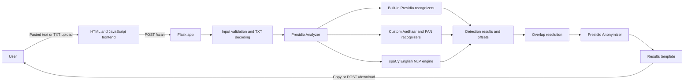
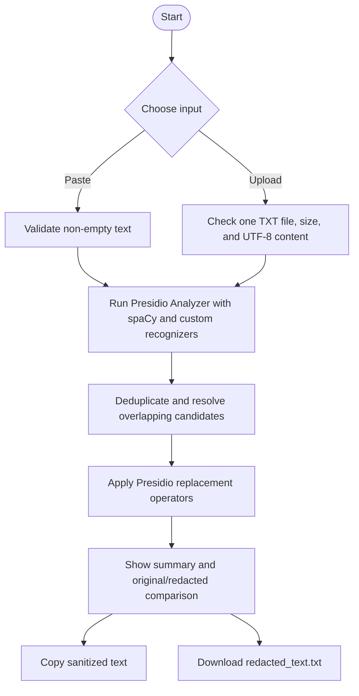

# Automated PII & Sensitive Data Redaction Tool

## 1. Project Title

**SecureText — Automated PII & Sensitive Data Redaction Tool**

## 2. Project Overview

SecureText is a small Flask web application that accepts pasted text or one
UTF-8 `.txt` file, detects selected personally identifiable information (PII),
and returns a redacted version with placeholders. It combines Presidio
Analyzer's recognizer framework, spaCy named entity recognition (NER), and
custom Presidio pattern recognizers for Indian Aadhaar-style and PAN-style
identifiers.

## 3. Problem Statement

Emails, reports, and other text can contain names, contact details, locations,
and identifiers that should not be shared. Finding and removing these values
manually is time-consuming and inconsistent. A tool can assist by highlighting
likely sensitive spans and producing a version in which detected spans are
replaced with placeholders.

## 4. Project Objectives

- Accept either text pasted into a form or a single TXT upload.
- Use NLP and pattern recognizers to identify supported entities.
- Preserve source-text offsets so detections refer to the exact input spans.
- Replace detected spans with readable placeholders.
- Show an entity count summary and an original-versus-redacted comparison.
- Allow the redacted text to be copied or downloaded.
- Keep processing simple: no database and no permanent upload storage.

## 5. Proposed Solution

The browser sends the selected input to Flask. Flask validates it, calls the
independent detection module, passes those results to the redaction module,
and renders a result page. Uploads and download responses are handled in
memory. The application does not save uploaded documents to a project folder
or database.

## 6. Technology Stack

| Technology | Use in this project |
| --- | --- |
| Python | Detection, redaction, file handling, and application code |
| Flask | Web application and `/`, `/scan`, and `/download` routes |
| spaCy (`en_core_web_sm`) | English NLP engine and named entity recognition |
| Microsoft Presidio Analyzer | Recognizer registry, analysis, entity types, and scores |
| Microsoft Presidio Anonymizer | Applies replacement operators to detected spans |
| Regular expressions | Custom format recognizers for Aadhaar-style and PAN-style values |
| HTML, CSS, JavaScript | Templates, responsive visual design, and browser interactions |
| Pytest | Automated detector, anonymizer, and route tests |

Dependency versions are pinned in [`requirements.txt`](requirements.txt).

## 7. System Architecture

The detection package can be imported and used without launching Flask. The
web application composes that reusable detector with the anonymizer and
in-memory file helper.



## 8. Folder Structure

```text
PII-Redaction-Tool/
├── app.py
├── config.py
├── requirements.txt
├── README.md
├── .gitignore
├── detection/
│   ├── __init__.py
│   ├── pii_detector.py
│   └── custom_patterns.py
├── redaction/
│   ├── __init__.py
│   └── anonymizer.py
├── utils/
│   ├── __init__.py
│   └── file_handler.py
├── templates/
│   ├── base.html
│   ├── index.html
│   └── results.html
├── static/
│   ├── css/style.css
│   ├── js/script.js
│   └── images/
└── tests/
    ├── __init__.py
    ├── test_detector.py
    ├── test_anonymizer.py
    └── test_routes.py
```

`detection/` has no Flask dependency. `redaction/` consumes detection results;
`utils/` handles uploaded TXT files; templates and static assets form the
frontend; and `tests/` covers the independent modules and HTTP routes.

## 9. Application Workflow



The form accepts only one input source at a time. Empty input, unsupported
extensions, oversized uploads, invalid UTF-8, and invalid text content are
rejected with a user-facing message. A scan with zero detections is still a
successful scan.

## 10. NLP Techniques Used

### How the terms differ

- **Named Entity Recognition (NER):** NLP that identifies named items in
  context, such as a person or location. spaCy's English model provides NER
  output to Presidio's spaCy NLP engine.
- **Regex pattern matching:** Checks whether text follows a specified
  character pattern. It is useful for structured formats, but does not
  understand their real-world meaning or validate official issuance.
- **PII detection:** The broader analysis step. Presidio runs its configured
  recognizers, combines NLP and pattern-based results, and returns entity
  types, confidence scores, and character offsets.
- **Anonymization:** Transforms detected spans. In this application Presidio
  Anonymizer applies replacement operators to the specified offsets.
- **Redaction:** The user-facing privacy operation: detected source spans are
  hidden by replacing them with placeholders. This implementation performs
  text replacement; it does not edit PDF, Word, or other document formats.

### How spaCy and Presidio work together

`detection/pii_detector.py` configures Presidio with spaCy as its NLP engine
and `en_core_web_sm` as the English model. Presidio supplies the analyzer and
recognizer framework; the spaCy recognizer can use NER labels such as person
and location, while other Presidio recognizers identify structured entities
such as emails, phone numbers, dates, URLs, and IP addresses. The project
registers two additional Presidio recognizers for Indian identifier formats.

Presidio returns half-open offsets (`start` inclusive, `end` exclusive) into
the original Python string. Exact duplicate entity/span candidates are
consolidated. Distinct overlapping candidates are ranked by score, span
length, and stable priority; retained results include metadata about
suppressed conflicts. The original source text is not included in conflict
metadata.

## 11. PII Categories Supported

The detector currently requests these entity types from Presidio:

| Detector entity type | Typical meaning | Placeholder |
| --- | --- | --- |
| `PERSON` | Person name | `[NAME]` |
| `EMAIL_ADDRESS` | Email address | `[EMAIL]` |
| `PHONE_NUMBER` | Phone number | `[PHONE]` |
| `LOCATION` | Place or location | `[LOCATION]` |
| `DATE_TIME` | Date or time | `[DATE]` |
| `URL` | Web address | `[URL]` |
| `IP_ADDRESS` | IP address | `[IP_ADDRESS]` |
| `IN_AADHAAR` | Aadhaar-style pattern | `[AADHAAR]` |
| `IN_PAN` | PAN-style pattern | `[PAN]` |

`CREDIT_CARD` has a placeholder mapping in the anonymizer, but it is **not**
currently requested by this application's detector. A mapping by itself does
not enable recognition. Unknown entity types use `[PII]`.

## 12. Custom Indian Aadhaar and PAN Recognizers

`detection/custom_patterns.py` defines Presidio `PatternRecognizer`
instances, and `pii_detector.py` registers them in Presidio's recognizer
registry.

- **Aadhaar-style:** Matches 12 digits, either together or in groups of four
  separated by optional spaces or hyphens. Word boundaries reduce matches
  embedded in longer alphanumeric strings. This checks format only; it does
  not verify an officially issued or valid Aadhaar number.
- **PAN-style:** Matches five uppercase letters, four digits, and one
  uppercase letter, with word boundaries to avoid matches embedded in a
  longer alphanumeric string. It checks the common shape only and does not
  verify the PAN's official validity.

The custom entity names returned by detection are `IN_AADHAAR` and `IN_PAN`.

## 13. Redaction Methodology

`redaction/anonymizer.py` validates supplied spans and calls the public
`detect_pii` function when detections were not supplied. It includes
suppressed conflict spans so that an overlapping candidate does not leave
part of a detected range visible. Presidio Anonymizer performs the actual
replacement using an entity-specific `replace` operator.

Exact duplicate spans are deduplicated. Intersecting spans are merged into a
single span, while adjacent spans remain separate. A merged span with
different entity types uses `[PII]` when a specific label would be
ambiguous. One known contained match is treated specifically: a URL span
inside an email span does not change the email placeholder to `[PII]`.
Other ambiguous overlaps, including some pattern/NLP collisions, can still
produce `[PII]`. Unmatched text, punctuation, and line breaks are preserved.

`get_entity_summary()` reports retained entity totals and types, plus separate
counts for suppressed candidates. It does not include detected source values.

## 14. Frontend Features

- Light, responsive SecureText interface with Home, How It Works, and About
  navigation.
- Paste-text and TXT-upload modes; character count, clear action, drag/drop,
  file-size/type feedback, and submission loading state.
- Results summary and entity-category cards based on the current scan.
- Original and redacted text comparison; detected source spans are highlighted.
- Copy-to-clipboard feedback and a TXT download action.
- Result data is serialized with Jinja's `tojson`; JavaScript constructs
  highlighted text using DOM text nodes rather than inserting user content as
  HTML.

## 15. Backend Architecture

- `app.py` provides `GET /`, `POST /scan`, and `POST /download`, initializes
  Flask-WTF CSRF protection, and renders generic errors without logging the
  submitted text.
- `config.py` holds the environment-based secret, cookie settings, allowed
  extension, request limit, and 2 MiB upload limit.
- `detection/pii_detector.py` exposes `detect_pii(text)` independently of
  Flask.
- `redaction/anonymizer.py` exposes `redact_text(text, detections=None)` and
  `get_entity_summary(detections)`.
- `utils/file_handler.py` validates extensions, limits bytes read, decodes
  UTF-8 (including a UTF-8 BOM), rejects NUL bytes, and never saves the upload.

Uploads are limited to **2 MiB** and `.txt` files. The download is generated
from an in-memory byte stream and has a fixed filename. The download endpoint
returns the submitted `redacted_text`; it does not independently verify that
the submitted text was produced by a scan.

## 16. Installation Instructions

The commands below use PowerShell on Windows. Run them from the project
directory:

```powershell
python -m venv .venv
.\.venv\Scripts\Activate.ps1
python -m pip install --upgrade pip
python -m pip install -r requirements.txt
```

The requirements file includes the pinned `en_core_web_sm` model wheel. If
the model is unavailable after installation, install it with:

```powershell
python -m spacy download en_core_web_sm
```

On macOS/Linux, activate the environment with
`source .venv/bin/activate` instead.

## 17. Environment Setup

For local development, the application creates a temporary secret key when
`FLASK_SECRET_KEY` is not set. To enable Flask debug mode in PowerShell:

```powershell
$env:APP_ENV = "development"
$env:FLASK_DEBUG = "1"
```

For a deployment environment, set a private, persistent secret and do not
commit it:

```powershell
$env:APP_ENV = "production"
$env:FLASK_SECRET_KEY = "<set-a-long-random-secret>"
$env:SESSION_COOKIE_SECURE = "1"
```

Production mode requires `FLASK_SECRET_KEY`; secure cookies should be used
over HTTPS. Do not use Flask's development server as a production server.

## 18. How to Run the Project

With the virtual environment activated:

```powershell
python app.py
```

Open the local address printed by Flask (normally
`http://127.0.0.1:5000/`). The homepage form posts to `/scan`; the results
page posts sanitized text to `/download`.

## 19. Testing Instructions

Run the complete test suite:

```powershell
python -m pytest -q
```

Check dependency consistency:

```powershell
python -m pip check
```

The tests cover live detector examples (and exact offsets), redaction
placeholders and overlap behavior, and Flask routes including input
validation, CSRF, uploads, downloads, safe HTML rendering, and generic error
responses. Detector tests require the Presidio dependencies and spaCy model
from `requirements.txt`.

## 20. Sample Input and Output

Example input:

```text
Alice Johnson can be reached at alice@example.com.
```

Example output from the current detector and anonymizer:

```text
[NAME] can be reached at [EMAIL].
```

Actual results depend on recognizer matches. For example, an ambiguous
overlapping span can use `[PII]` instead of a more specific placeholder.
The results page also displays entity counts and highlights the detected
source spans.

## 21. Limitations

- Automated recognizers may miss information or produce false positives;
  results require human review.
- spaCy NER is statistical and context-dependent. Names and locations can be
  ambiguous.
- Regex checks a format, not official issuance or validity of Aadhaar/PAN.
- Overlap resolution can produce a generic `[PII]` placeholder when multiple
  entity types cover the same range.
- Credit-card placeholder support exists, but credit cards are not currently
  included in the detector's requested entity list.
- The application accepts pasted text and TXT only; PDF and DOCX are not
  implemented.
- There is no database, user account, authentication, or scan history.
- Uploads are processed in memory, but original text is necessarily present
  in the active request and results page while the user is using the app.
- The download route trusts its posted text and does not certify that it is
  sanitized.
- The built-in Flask development server is for local demonstration, not
  production hosting.

## 22. Future Scope

Possible future work, not currently implemented:

- Add carefully validated PDF/DOCX extraction and redaction workflows.
- Add configurable entity selection and placeholder styles.
- Add user review/editing of detected spans before downloading.
- Consider supported credit-card detection after adding it to the analyzer
  entity list and its tests.
- Improve overlap explanations and expose suppressed candidates in the
  results report.
- Add larger test corpora, additional languages/models, and measured
  evaluation. Any accuracy or performance claims should be based on a
  documented evaluation rather than assumed.
